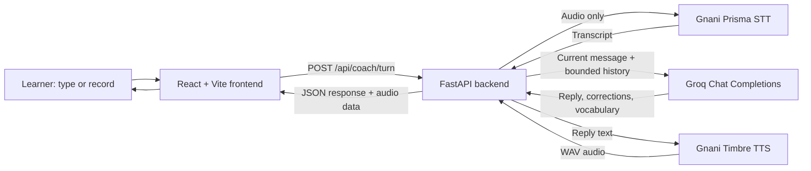

# Bollo

**Speak more. Fear less.**

An AI-powered English-speaking and communication coach for Indian students and young professionals building fluency, pronunciation, vocabulary, and confidence.

    

## Project Overview

Bollo gives learners a low-pressure place to practise speaking and receive conversational feedback. The current application includes a landing page, dashboard, AI Speaking Coach, GD Arena preview, and progress dashboard. The coach accepts typed messages and browser microphone recordings.

The Groq coaching path is working: real provider requests, including conversation chaining, have been verified. The GD Arena and progress screens are explicitly demos, and Interview Practice is planned. See [Key Features](#key-features) for the status of each feature.

## Problem Statement

Many students and young professionals understand English but have limited opportunities to practise speaking with feedback. This can make interviews, group discussions, and everyday professional communication harder, especially for learners without access to traditional coaching.

## Our Solution

Bollo combines browser-based speech capture, transcription, a conversational language model, and speech playback in one practice flow. Learners can also type instead of recording. Bollo responds to the message, offers relevant grammar and vocabulary suggestions, and keeps recent turns in context during a practice session.

## Key Features

| Feature | Status | What is available |
| --- | --- | --- |
| AI Speaking Coach | Implemented | Text and microphone input, conversation history, spoken replies, and proficiency selection. |
| Speech transcription and AI feedback | Implemented | Gnani Prisma transcribes microphone audio; Groq generates a coaching response. |
| Vocabulary and communication corrections | Implemented | The coach can return relevant vocabulary and gentle corrections with its response. |
| Group Discussion Arena | Preview | Example discussion rooms and guidance are shown. Live group sessions are not implemented. |
| Interview Practice | Planned | Interview coaching is a future direction; there is no separate interview workflow yet. |
| Progress Tracking | Demo data | The screen shows sample practice metrics. It is not connected to saved user activity. |

## Technology Stack

| Area | Technology |
| --- | --- |
| Frontend | React 18, Vite 6, TypeScript 5.6, Tailwind CSS 3, Lucide React |
| Backend | Python, FastAPI, Pydantic, Uvicorn |
| Language model | Groq Python SDK (`AsyncGroq`), Chat Completions, default model `openai/gpt-oss-120b` |
| Speech-to-text | Gnani Prisma (`prisma-v3.0`, English India locale) |
| Text-to-speech | Gnani Timbre (default `timbre-v2.5`, voice `Nalini`) |
| Supporting libraries | HTTPX, python-dotenv, python-multipart |

## System Architecture



Conversation history is held in process-local memory: at most 256 sessions, 20 messages per session, with a 30-minute inactivity expiry. It is not persisted and is cleared when the backend process restarts.

## Application Screenshots

No genuine screenshot files are currently included in the repository. Screenshots have intentionally not been fabricated. Add captured images under `docs/screenshots/` and reference them here when available.

## Project Structure

```text
Bollo/
├── backend/
│   ├── app/
│   │   ├── main.py             # FastAPI routes and health check
│   │   └── services.py         # Groq, Prisma, Timbre, and conversation history
│   ├── scripts/                # Live Groq and voice-flow smoke checks
│   ├── tests/                  # Backend regression tests
│   ├── .env.example            # Environment variable template
│   └── requirements.txt
├── docs/
│   └── Bollo_Solution_Pitch.pdf
├── src/
│   ├── App.tsx                 # Screens and coach UI
│   ├── apiError.ts             # Safe API error display
│   ├── coachReliability.ts     # Transcript and microphone helpers
│   └── styles.css
├── index.html
├── package.json
├── package-lock.json
├── vite.config.ts
└── README.md
```

## Installation and Local Setup

### Prerequisites

- Node.js 22 or newer for the complete frontend test command; npm is included with Node.js.
- Python 3.10 or newer.
- Local API credentials for Groq and Gnani for live coach functionality.

### Install

From the repository root:

```bash
npm ci
cd backend
python3 -m venv .venv
source .venv/bin/activate
python -m pip install -r requirements.txt
test -f .env || cp .env.example .env
```

Edit `backend/.env` locally and add the required values described below. Keep that file private; it is ignored by Git.

### Run the backend

From `backend/` with the virtual environment activated:

```bash
uvicorn app.main:app --reload --host 127.0.0.1 --port 8000
```

FastAPI health check: <http://127.0.0.1:8000/health>  
Interactive API documentation: <http://127.0.0.1:8000/docs>

### Run the frontend

In a second terminal, from the repository root:

```bash
npm run dev
```

Open the local URL printed by Vite (normally <http://localhost:5173>). Vite proxies `/api` and `/health` to the FastAPI server at `127.0.0.1:8000`.

## Environment Variables

Start with [`backend/.env.example`](backend/.env.example). The backend loads `backend/.env`; credentials are never required in the frontend.

| Variable | Required | Default | Purpose |
| --- | --- | --- | --- |
| `GROQ_API_KEY` | Yes for coaching | — | Authenticates Groq Chat Completions. |
| `GNANI_API_KEY` | Yes for microphone transcription and generated speech | — | Authenticates Gnani Prisma and Timbre. |
| `GROQ_MODEL` | No | `openai/gpt-oss-120b` | Groq model used for coach replies. |
| `GNANI_TTS_MODEL` | No | `timbre-v2.5` | Timbre voice model. |
| `GNANI_TTS_VOICE` | No | `Nalini` | Timbre voice; choose one supported by the configured model. |

Example values are documented in `.env.example`; do not commit credentials or copy real values into documentation.

## API and Service Integrations

The frontend calls the backend; provider credentials and requests remain server-side.

| Method and route | Request | Response / behavior |
| --- | --- | --- |
| `GET /health` | None | Reports whether Groq and Gnani keys are configured. Never returns key values. |
| `POST /api/coach/turn` | Multipart form: `text` or `audio_file`; optional `conversation_id` and `proficiency` (`beginner`, `intermediate`, or `advanced`). | Returns `transcript`, `reply`, `corrections`, `vocabulary`, `conversation_id`, `audio_base64`, `audio_mime_type`, `audio_error`, and `speech_to_text`. Audio uses Prisma → Groq → Timbre; text skips Prisma. |
| `POST /api/coach/transcribe` | Multipart form with `audio_file`. | Returns Prisma `transcript`, `detected_language_code`, and `request_id`. |
| `POST /api/coach/respond` | JSON: `text`, optional `conversation_id`, optional `proficiency`. | Returns `reply`, `corrections`, `vocabulary`, and `conversation_id` from Groq. |
| `POST /api/coach/speak` | JSON: `text`. | Returns `audio_base64` and `audio_mime_type` from Timbre. |

Groq Chat Completions receives the coaching system instruction plus the current user message and recent user/assistant messages. Bollo generates a random conversation ID for a new session and reuses it for subsequent turns. Unknown or expired IDs return HTTP 409 so the user can start a new practice session. No database or Redis is used.

Gnani Prisma transcribes browser recordings. Empty or recognized non-speech transcripts are stopped before a normal coaching turn. The current coach does not provide phoneme-level pronunciation scoring. Gnani Timbre creates WAV audio; if speech synthesis fails, the text response remains available and the response includes an `audio_error` message.

## Future Scope

- Live, structured group discussions in the GD Arena.
- A dedicated interview practice flow.
- Persistent accounts and progress data, replacing the current sample metrics.
- Durable conversation storage if deployment needs sessions to survive restarts or span multiple backend workers.

These items are planned; they are not represented as current functionality.

## Contributing

Contributions are welcome. Before proposing a change:

1. Create a focused branch and keep changes scoped to one improvement.
2. Install dependencies using the setup above.
3. Run the backend regression suite from `backend/` with `pytest -q`.
4. Run frontend checks from the repository root with `npm run test:frontend` and `npm run build`.
5. Describe user-visible changes and any provider credentials or setup needed to verify them. Never include secrets in commits or issue attachments.

There is no license file or confirmed licensing decision in the repository, so this README does not state a license.
